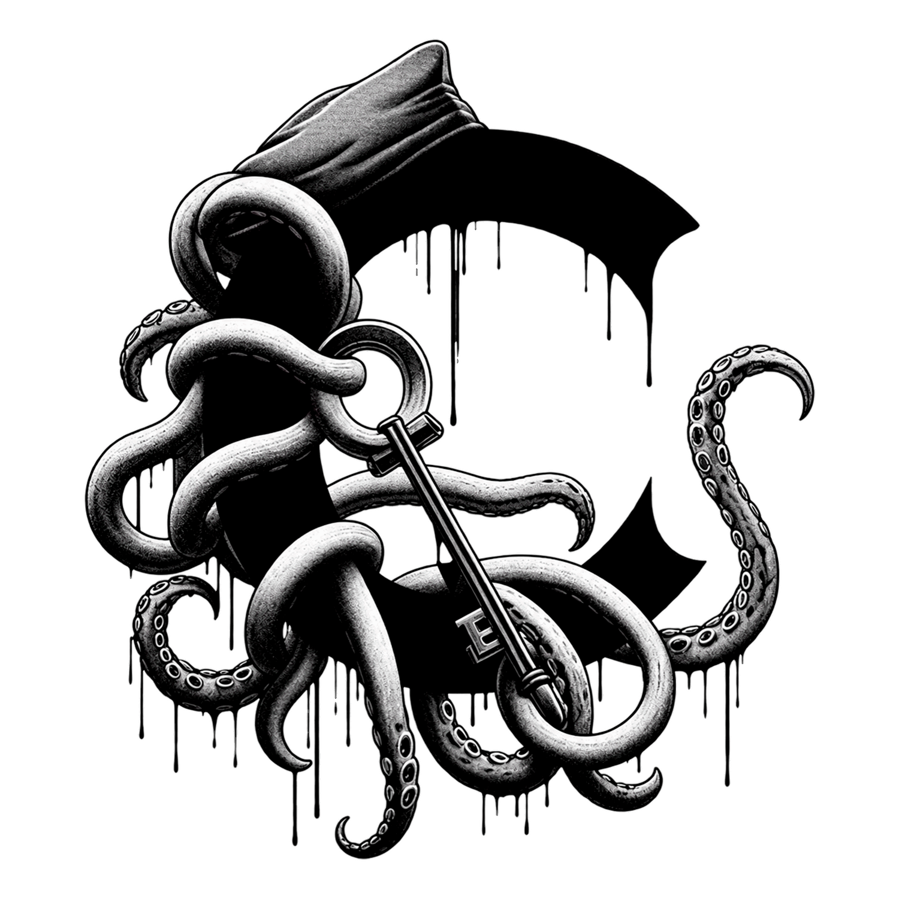
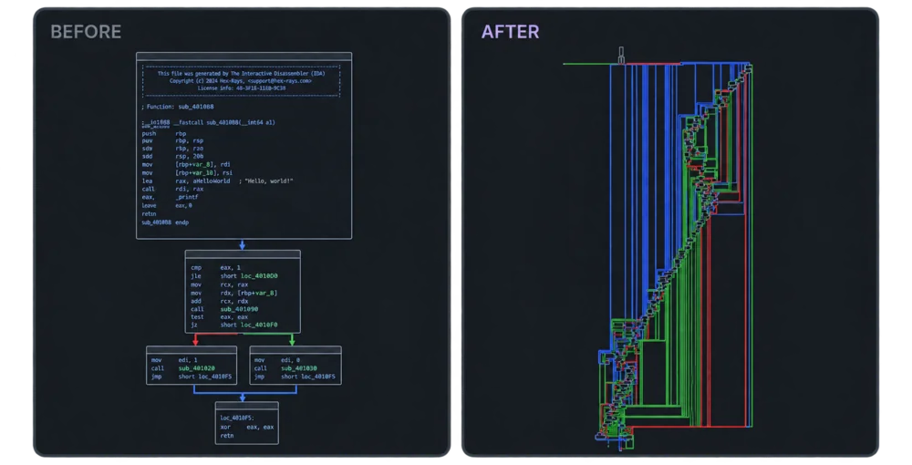
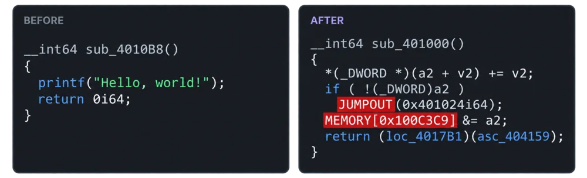
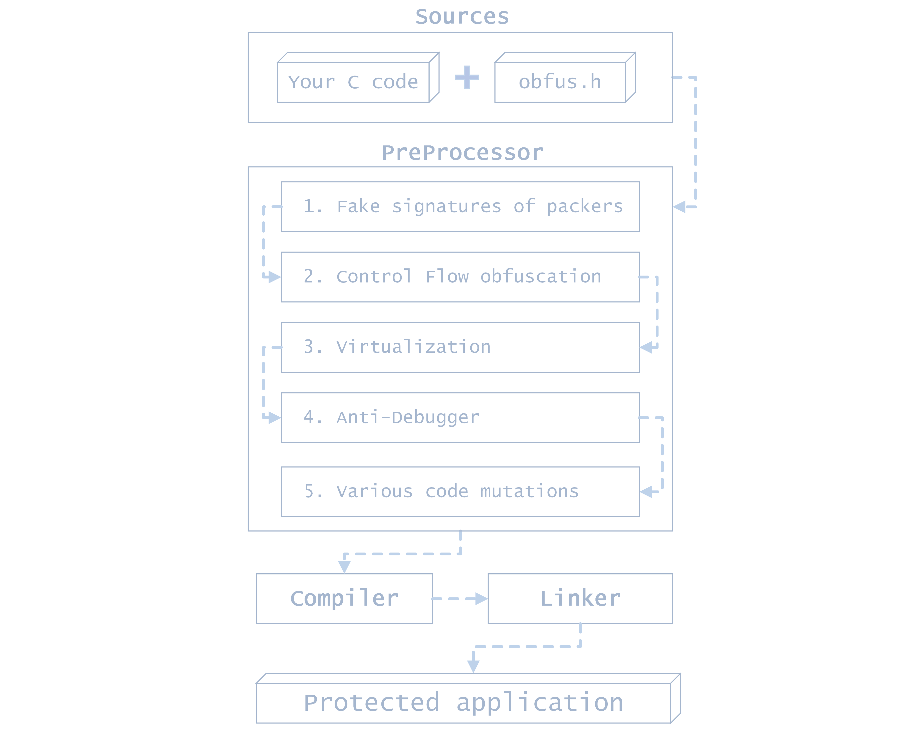

<p align="center"></p>

<h1 align="center">obfus.h</h1>

<p align="center">Aggressive polymorphic protection for native code. One header. Completely free.</p>

<p align="center">
  
  <a href="#-compiler-important"></a>
  <a href="LICENSE"></a>
</p>

<p align="center"><strong><a href="#-usage">Get started</a> • <a href="https://github.com/DosX-dev/obfus.h/releases/tag/daily-crackme">Download the crackmes</a></strong></p>

**[obfus.h](https://github.com/DosX-dev/obfus.h/blob/main/include/obfus.h)** brings compile-time polymorphic obfuscation to **C applications and libraries on Windows x86 and x64**, built specifically for **[TinyCC](#-compiler-important)**. Turn familiar control flow into tangled paths, obscure calls, hide selected strings and virtualize sensitive calculations. Include the header and build: protection becomes part of your binary.

*Just seeing obfus.h in your binary will make a reverse engineer question the existence of God.*

### What makes it worth using

- 🧬 **The same logic. Many different forms.** Instruction sequences, constants and control-flow layouts vary across protected sites and build seeds.
- 🔄 **Familiar logic. Unfamiliar control flow.** Automatic protection transforms conditions, loops and returns, complicating reconstruction of the original program structure.
- 🛡️ **Protection beyond branches.** Combine call obfuscation, runtime string construction, anti-debugging and optional virtualization. Common Windows API and CRT calls receive protection automatically.
- 📦 **One header. Direct integration.** Build protection directly into your application during compilation, using your existing TCC build.
- 🔓 **Free, including commercial use.** Open source, with every protection feature included. No paid tiers or feature gates.
- 🕹️ **Real binaries to take apart.** Download generated crackmes at four difficulty levels and judge the protection yourself.

## 📖 Protection in practice

**Easy to integrate. Unpleasant to reverse.** Polymorphic transformations complicate the path from machine code back to readable logic. They reshape branches, calls and calculations while preserving the intended behavior of the program.

The comparisons below illustrate the transformation. The resulting graph and decompiled output vary with the code, build settings and analysis tool.

### Control-flow graph



### Decompiled output



## 🕹️ [Daily Crackmes](https://github.com/DosX-dev/obfus.h/releases/tag/daily-crackme)

**See the protection. Take it apart. Judge it yourself.**

Four levels: **Easy, Medium, Hardcore and Extreme**. Generated verification logic changes the challenge itself, not just its password. Download ready-to-run Windows binaries, sharpen your reverse-engineering skills and explore the generated protection without setting up a compiler. **Download. Disassemble. Find the password.**

New crackmes are published daily. The scheduler is set for **13:00 Moscow time (UTC+3)**, but the actual publication time depends on GitHub Actions' mood.

## 🎯 Intended use

**Protect the logic that makes your software yours.** Apply protection to native components containing proprietary algorithms, licensing checks or other sensitive logic. Choose the mechanisms and settings that fit the component's performance requirements.

For larger projects, isolate that logic in **C DLLs compiled with TCC**. The main application can keep its existing toolchain — **C#, C++**, another language, or **C compiled with GCC, LLVM/Clang or Visual C** — and call the protected DLLs through their exported interfaces.

You can also combine the resulting binaries with commercial protectors and packers. Check compatibility with the chosen protector and settings before distribution.

> [!IMPORTANT]
> **Make reverse engineering cost more time and effort.** Layered, polymorphic protection complicates analysis and recovery of your program's logic. The goal is to raise the effort required to recover protected logic, rather than promise immunity to reverse engineering.

This project is intended to protect lawful software, including commercial applications and crackmes. Its author categorically opposes any malicious use. This statement is not a license condition, but projects involving malicious activity will receive no support from the author or the development team.

## 👾 Usage

Download **[TinyCC 0.9.28rc from TinyCC-builder](https://github.com/DosX-dev/TinyCC-builder/releases/latest)** and place **[obfus.h](https://github.com/DosX-dev/obfus.h/blob/main/include/obfus.h)** in your project. Include it **after standard and system headers**, before the code you want to protect:

```c
#include "obfus.h"
```

Build with TCC as usual. Automatic protection is enabled by default; use markers and `HIDE_STRING` for additional protection at selected points. IntelliSense remains available.

Automatic control-flow protection covers `if`, `else`, `case`, `break`, `switch`, `while`, `for`, `return`, `continue`, `default` and `do`. Use the `BREAK_STACK_CFLOW;` and `STACK_PROXY_FUNCTIONS;` markers to add protection at selected points in your code.

Enable `OBFH_BETTER_CONTROL_FLOW` for an additional layer of control-flow protection, with higher runtime cost.

### Choose your build variants

`OBFH_SEED` is an unsigned 32-bit build seed (default: `0u`). Change it to generate different protection layouts for the same program behavior. Source changes can also affect the generated protection.

For command-line builds, use `-DOBFH_SEED=123456789u`. The seed can be stored openly in your build configuration; reproducing a binary also requires matching the source, compiler and build settings.

Define options **before** including the header. For example, to enable the additional control-flow and anti-debugging mechanisms:

```c
#define OBFH_SEED                   123456789u
#define OBFH_BETTER_CONTROL_FLOW    1
#define OBFH_BETTER_ANTIDEBUG       1

#include "obfus.h"

```

### Option reference

Choose individual options to match your protection and performance requirements.

| Option                     | Effect when set to `1`                                                  |
| -------------------------- | ----------------------------------------------------------------------- |
| `OBFH_BETTER_CONTROL_FLOW` | Add another layer of control-flow mutation, with higher execution cost. |
| `OBFH_BETTER_ANTIDEBUG`    | Add hardware-breakpoint checks to anti-debugging protection.            |
| `OBFH_FAKE_SIGNATURES`     | Add fake protector/packer signatures for crackme and CTF challenges.    |

For debugging or selective disabling:

| Option                         | Effect when set to `1`                      |
| ------------------------------ | ------------------------------------------- |
| `OBFH_DISABLE_ANY_OBFUSCATION` | Disable obfuscation.                        |
| `OBFH_DISABLE_CONTROL_FLOW`    | Disable automatic control-flow protection.  |
| `OBFH_DISABLE_ANTIDEBUG`       | Disable built-in anti-debugging protection. |
| `OBFH_DISABLE_PDATA_DECOYS`    | Disable additional x64 fake functions.      |

> [!WARNING]
> **Reserve `OBFH_FAKE_SIGNATURES` for crackme/CTF challenges; avoid it in production software.** Fake protector and packer signatures can trigger antivirus detections and cause tools such as Detect It Easy to flag the binary as suspicious or potentially malicious.

You can also select options on the command line:

```bat
tcc "app.c" -w -DOBFH_SEED=123456789u -DOBFH_BETTER_ANTIDEBUG=1
```

> [!TIP]
> Use `-w` to suppress warnings generated by the protection during compilation.

Calls to many common MSVCRT functions automatically trigger anti-debugging checks. Place the `ANTI_DEBUG;` marker where you need an additional check:

```c
ANTI_DEBUG;
if (!licenseExpired()) {
    // ...
}
```

## 🧶 Strings hiding

**Hide selected string literals.** Use the `HIDE_STRING(str)` construct inside functions to build strings at runtime instead of storing them as plain text in the binary.

The returned pointer remains valid until the enclosing block ends. For longer-lived or static storage, copy the string into your own buffer at runtime. Contents can be recovered through code analysis or runtime inspection.

```c
char *hidden_message = HIDE_STRING("Hello, world!");
// ...
printf("%s", hidden_message);
```

An example of runtime string construction in x86-64 disassembly:

```asm
  ; ; ; ; ; ; ; ; ; ; ; ; ; ; ; ; ; ; ; ; ; ; ; ; ; ; ; ; ; ; ; ; ;
  ; PROTECTED STRING:                  ; ORIGINAL STRING:         ;
  mov eax, 48h                         lea rax, aHelloWorld       ;
  mov [rbp-0Fh], al                    mov r11, rax               ;
  mov eax, 65h                         ; . . .                    ;
  mov [rbp-0Eh], al                                               ;
  mov eax, 6Ch                                                    ;
  mov [rbp-0Dh], al                                               ;
  mov eax, 6Ch                                                    ;
  mov [rbp-0Ch], al                                               ;
  mov eax, 6Fh                                                    ;
  mov [rbp-0Bh], al                                               ;
  mov eax, 2Ch                                                    ;
  ; etc . . .                                                     ;
  ; ; ; ; ; ; ; ; ; ; ; ; ; ; ; ; ; ; ; ; ; ; ; ; ; ; ; ; ; ; ; ; ;
```

## 👺 Virtualization

**Put selected calculations behind a virtual instruction set.** Use `VM_*` markers to express sensitive arithmetic and comparisons through VM operations.

The virtual machine is included automatically when you use `VM_*` markers; unused VM functions add no weight to your binary. With `OBFH_DISABLE_ANY_OBFUSCATION=1`, these markers expand to ordinary calculations.

> [!WARNING]
> **Focus virtualization on sensitive calculations.** VM protection adds runtime overhead; measure performance when using it in frequently executed code.

| Marker           | Type           | Op   | Description              | Example                              |
| ---------------- | -------------- | ---- | ------------------------ | ------------------------------------ |
| **`VM_ADD`**     | _long_         | `+`  | Addition                 | `VM_ADD(5, 3)` = **`8`**             |
| **`VM_SUB`**     | _long_         | `-`  | Subtraction              | `VM_SUB(5, 3)` = **`2`**             |
| **`VM_MUL`**     | _long_         | `*`  | Multiplication           | `VM_MUL(5, 3)` = **`15`**            |
| **`VM_DIV`**     | _long_         | `/`  | Division                 | `VM_DIV(6, 3)` = **`2`**             |
| **`VM_MOD`**     | _long_         | `%`  | Remainder                | `VM_MOD(5, 3)` = **`2`**             |
| **`VM_AND`**     | _unsigned int_ | `&`  | Bitwise AND              | `VM_AND(6, 3)` = **`2`**             |
| **`VM_OR`**      | _unsigned int_ | `\|` | Bitwise OR               | `VM_OR(6, 3)` = **`7`**              |
| **`VM_XOR`**     | _unsigned int_ | `^`  | Bitwise XOR              | `VM_XOR(6, 3)` = **`5`**             |
| **`VM_NOT`**     | _unsigned int_ | `~`  | Bitwise NOT              | `VM_NOT(0)` = **`0xFFFFFFFFu`**      |
| **`VM_SHL`**     | _unsigned int_ | `<<` | Left shift               | `VM_SHL(1, 3)` = **`8`**             |
| **`VM_SHR`**     | _unsigned int_ | `>>` | Right shift, zero-filled | `VM_SHR(8, 3)` = **`1`**             |
| **`VM_EQU`**     | _BOOL_         | `==` | Equal                    | `VM_EQU(5, 5)` = **`true`**          |
| **`VM_NEQ`**     | _BOOL_         | `!=` | Not equal                | `VM_NEQ(5, 3)` = **`true`**          |
| **`VM_LSS`**     | _BOOL_         | `<`  | Less than                | `VM_LSS(3, 5)` = **`true`**          |
| **`VM_GTR`**     | _BOOL_         | `>`  | Greater than             | `VM_GTR(5, 3)` = **`true`**          |
| **`VM_LEQ`**     | _BOOL_         | `<=` | Less or equal            | `VM_LEQ(3, 5)` = **`true`**          |
| **`VM_GEQ`**     | _BOOL_         | `>=` | Greater or equal         | `VM_GEQ(5, 3)` = **`true`**          |
| **`VM_ADD_DBL`** | _long double_  | `+`  | Addition                 | `VM_ADD_DBL(5.5, 3.2)` = **`≈8.7`**  |
| **`VM_SUB_DBL`** | _long double_  | `-`  | Subtraction              | `VM_SUB_DBL(5.5, 3.2)` = **`≈2.3`**  |
| **`VM_MUL_DBL`** | _long double_  | `*`  | Multiplication           | `VM_MUL_DBL(5.5, 3.2)` = **`≈17.6`** |
| **`VM_DIV_DBL`** | _long double_  | `/`  | Division                 | `VM_DIV_DBL(6.0, 3.0)` = **`≈2.0`**  |
| **`VM_LSS_DBL`** | _BOOL_         | `<`  | Less than                | `VM_LSS_DBL(3.5, 5.2)` = **`true`**  |
| **`VM_GTR_DBL`** | _BOOL_         | `>`  | Greater than             | `VM_GTR_DBL(5.5, 3.2)` = **`true`**  |

> For floating-point comparisons, use `VM_LSS_DBL` and `VM_GTR_DBL`.

The following markers route condition checks through a VM proxy layer, adding another layer of complexity to branch analysis:

| Marker          | Description               |
|-----------------|---------------------------|
| **`VM_IF`**     | Use instead of `if`       |
| **`VM_ELSE_IF`**| Use instead of `else if`  |
| **`VM_ELSE`**   | Use instead of `else`     |

For example:

```c
// ...

// if ((2 + 2) == 4) { ... }
VM_IF(VM_EQU(VM_ADD(2, 2), 4)) {
    printf("2 + 2 == 4!");
}

// if (condition1) { ... }
// else if (condition2) { ... }
// else { ... }
VM_IF(condition1) {
    // if
} VM_ELSE_IF(condition2) {
    // else if
} VM_ELSE {
    // else
}
```

See [tests/vm.c](tests/vm.c) for further examples of VM markers.

## ❓ Example

This example combines automatic protection, `HIDE_STRING` and VM markers with enhanced control-flow and anti-debugging options.

Save it as `app.c` next to `obfus.h` and build with `tcc app.c -w -o app.exe`.

```c
#include <stdio.h>
#include <stdlib.h>
#include <string.h>

#define OBFH_SEED                   123321u
#define OBFH_BETTER_CONTROL_FLOW    1          // Additional control-flow mutation; higher runtime cost
#define OBFH_BETTER_ANTIDEBUG       1          // Additional hardware-breakpoint checks
#define OBFH_FAKE_SIGNATURES        0          // Enable only for crackme/CTF challenges

#include "obfus.h"

int main(void) {
    ANTI_DEBUG;

    char *out = malloc(256);
    STACK_PROXY_FUNCTIONS;

    if (out) {
        strcpy(out, HIDE_STRING("Hello, world!\n"));
        printf("%s", out);
    } else {
        printf("Allocation failed!\n");
        return 1;
    }

    free(out);

    int result = VM_ADD(5, 7);
    BREAK_STACK_CFLOW;

    VM_IF(VM_EQU(result, 12)) {
        printf("5 + 7 == 12\n");
    }

    return 0;
}
```

## 🤖 How it works



## 🛠 Compiler (important)

Use **TinyCC `0.9.28rc` from [TinyCC-builder](https://github.com/DosX-dev/TinyCC-builder/releases/latest)**, which includes the Windows headers, libraries and `obfh-update.cmd`. Use this package to get the compiler version required by the protection.

> [!NOTE]
> To build the latest compiler yourself, download [TinyCC-builder](https://github.com/DosX-dev/TinyCC-builder) and double-click `build.cmd`; sources and dependencies are downloaded automatically.

## 🌐 obfus.h updater

**`obfh-update.cmd` is already included in the standard [TinyCC-builder package](https://github.com/DosX-dev/TinyCC-builder/releases/latest), next to `tcc.exe`.**

Run it manually from your project directory or add it to your build pipeline. It downloads the latest `obfus.h` into the current directory:

```bat
call "C:\TinyCC\obfh-update.cmd"
if errorlevel 1 exit /b 1
"C:\TinyCC\tcc.exe" app.c -w
```

To update another directory, pass its relative or absolute path. The directory must exist; the filename is always `obfus.h`:

```bat
call "C:\TinyCC\obfh-update.cmd" "include"
call "C:\TinyCC\obfh-update.cmd" "C:\My project\include"
```

For standalone use, [download the script separately](include-updater/obfh-update.cmd).

## 🦎 Security Research and Community

**Research feeds back into the protection.** Community analysis and CTF writeups help identify weaknesses and guide improvements. Each article examines a specific sample and version, rather than establishing a universal method for removing protection.

- **[Defeating a Heavily Obfuscated Binary](https://vxcall.github.io/posts/defeating-a-heavily-obfuscated-binary/)** - A black-box analysis of an obfus.h-protected binary and techniques used to examine its protection.
- **[V1t CTF 2026 Writeup: 8 Challenges Solved](https://cybersecurityelite.com/ctf-writeups/v1t-ctf-2026-writeup/)** - Reverse engineering of the obfus.h-protected Sealed Input Verifier challenge.
- **[\[CTF\] 2024 CISCN x 长城杯 初赛逆向0解题-VT 解题全流程](https://www.52pojie.cn/thread-2008228-1-1.html#1)** - A CTF reversing walkthrough involving an earlier generation of obfus.h.
- **[ObfusHunter](https://github.com/hACKCASCAC/ObfusHunter)** - A community-built detector for identifying obfus.h protection in compiled binaries.

## 📄 License

**[MIT with a compiled-distribution exception](LICENSE).** Distributed EXEs, DLLs and other compiled binaries do not need to include attribution or the license text for obfus.h. When distributing obfus.h source code, modified versions or substantial portions of it, retain the copyright notice and license text. You do not need to disclose your application's source code.

## 🌈 Special thanks

I (DosX) couldn’t have made this project what it is today without your help. Thank you! ❤️

- 👨🏼‍💻 **[@horsicq](https://github.com/horsicq)** *(for help with the code and advice)*
- 🐺 **[@ac3ss0r](https://github.com/ac3ss0r)** *(for cool ideas and their solutions)*
- 🛡️ **[@AsoiX-exe](https://github.com/AsoiX-exe)** *(for testing and security audits)*
- 🤖 **[OpenAI](https://openai.com/)** *(for providing development grants)*

And **thanks to you** 🤝 for paying attention to this project!
