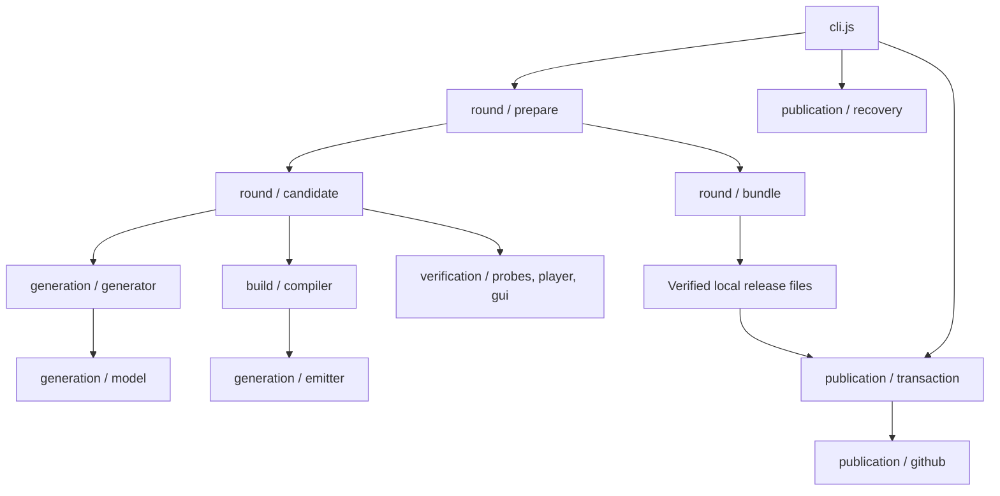

# Architecture and module contracts

Start with `cli.js`, then `src/round/prepare.js`. The CLI decides whether a run may publish; preparation produces a fully verified local bundle. Publication is a separate operation. Module filenames can evolve, but these responsibility and data boundaries should remain explicit.

## Execution flow

`preview` stops after preparation. `daily` first recovers durable state, loads saved answers/history, prepares today's next round, then publishes it. `acceptance` exercises a larger local compiler/GUI matrix without reaching publication.

## Module map

| Directory           | Responsibility                                                                                | Main modules                                                              |
| ------------------- | --------------------------------------------------------------------------------------------- | ------------------------------------------------------------------------- |
| `src/core/`         | Configuration, stable paths, cryptographic domains, bounded process execution and Moscow date | `config.js`, `paths.js`, `crypto.js`, `process.js`, `schedule.js`         |
| `src/generation/`   | Construct the IR, interpret/invert it, emit C, enforce level structure and measure variation  | `generator.js`, `model.js`, `emitter.js`, `difficulty.js`, `diversity.js` |
| `src/build/`        | Resolve/verify latest TinyCC and build private probes or public players                       | `toolchain.js`, `compiler.js`, `resource.js`, `unpack.ps1`                |
| `src/verification/` | Check native results, intermediate states, PE contents and GUI interactions                   | `probes.js`, `player.js`, `gui.js`, `acceptance.js`                       |
| `src/round/`        | Select verified candidates, assemble release files, retain/read history and answers           | `prepare.js`, `candidate.js`, `bundle.js`, `history.js`, `answers.js`     |
| `src/publication/`  | Validate release state, render descriptions, execute/recover transactions and call GitHub     | `state.js`, `description.js`, `publication.js`, `github.js`               |
| `src/ui/`           | Shared native player interface and its private Windows acceptance harness                     | `gui.c`, `gui-check.ps1`                                                  |

Paths are resolved relative to modules, not the terminal's working directory. `REPOSITORY_ROOT` identifies the source repository; `GAMIFICATION_ROOT` identifies this component. Generated sources and compiler caches stay in the same ignored directories regardless of the source layout.

## Dependency boundaries

Core modules do not depend on higher layers. Generation cannot build, verify or publish. The emitter reads the shared GUI source as a static template; its arithmetic translation remains independent of the JavaScript interpreter.

Build and verification do not import publication. Round preparation does not import the GitHub adapter: stored-answer/history readers receive an API object exposing read methods. The CLI supplies that adapter in daily mode. Publication consumes a prepared bundle and does not generate passwords, compile C or weaken failed checks.

`test/architecture.test.js` checks these import boundaries. Do not add an abstraction merely to shorten an import: a module should own a coherent responsibility. Avoid compatibility wrappers for unpublished internal module paths.

## Data contracts

### Challenge and IR

`generate(key, context)` returns `{ ir, target, password, fingerprint }`. The plaintext password is private. Context contains date, successful-round number, difficulty and deterministic attempt number. The separate HMAC domains for password, structure and obfuscation seed must remain independent.

`generation/fingerprint.js` owns structural and behavioral fingerprints and expression normalization; it does not draw random values or mutate the IR. `generator.js` constructs challenges and re-exports the fingerprint functions for existing callers. Moving this code must preserve hashes, random draw order and emitted C for identical inputs; it does not require a generator-version change.

The IR contains word width, logical coordinates, stages, physical storage permutation, function groups and the library seed. The model operates on logical coordinates; the emitter maps them to physical slots.

| Stage        | Contract                                                                                                                                                                |
| ------------ | ----------------------------------------------------------------------------------------------------------------------------------------------------------------------- |
| `affine`     | Per-coordinate ordered reversible operations; odd multiplication, nonzero rotation and shift-XOR bijections                                                             |
| `permute`    | A complete nonidentity coordinate permutation                                                                                                                           |
| `couple`     | Sequential reversible updates; each control expression excludes its destination; inverse updates run in reverse order                                                   |
| `feistel`    | Disjoint, potentially unequal source/destination partitions cover the block; simultaneous destination updates read only sources; a complete routing permutation follows |
| `substitute` | Independent bijective nonlinear nibble tables for each coordinate; inverse uses inverse table lookup                                                                    |
| `matrix`     | Two or three wired layers of invertible modular, ARX or multiplicative pair lifts                                                                                       |
| `spn`        | Generated interleaving of nonlinear substitutions and pair steps; reverse the actual operation schedule                                                                 |
| `controlled` | Generated predicates over distinct control words; conditional or masked-XOR swaps; reverse operation order restores controls                                            |
| `bitnetwork` | Conditional bit flips/swaps; nonlinear control truth tables; all control wires differ from destination wires; every gate is self-inverse, so reverse the schedule       |

`families.js` constructs the additional stage descriptions. `family-model.js` interprets/inverts them, and `family-emitter.js` independently emits forward C. A `couple` stage marked `round` is a full sequential nonlinear Hardcore round; it uses the same reversible update contract with more source dependencies.

Generator version 8 expands family word mixes from five to eight operations: XOR, addition, subtraction, odd multiplication, rotation, left/right XOR shifts and exchanges of adjacent equal-sized bit groups. These mixes participate in substitutions, pair programs, control predicates, bit routing and multi-source lifts on every difficulty. XOR shifts use a finite-series inverse; bit-group exchange is its own inverse. Existing nonlinear stages and difficulty requirements remain in place. Structural fingerprints include the operation kinds rather than treating changed constants alone as new algorithms.

`bit-network.js` owns bit-circuit construction, the truth-table interpreter and independent algebraic C emission. The interpreter reads immutable control wires before updating destinations; the emitter derives Boolean polynomials rather than calling the interpreter. Only bounded bit operations enter the existing VM helpers on Hardcore/Extreme.

The GUI executes one password verification on a worker thread. It captures and wipes a private input snapshot, temporarily disables editing and ignores repeated checks while busy. Mouse state painting and animations remain on the window thread. Completion joins the worker before publishing its verdict; closing during a check hides the window and destroys it after completion. No pending click jobs survive to overwrite a later result.

`gui-style.c` owns colors, window painting, rounded-shape rendering and the shared button painter/motion. The emitter inserts it at `/* @GUI_STYLE@ */` in `gui.c`, after window/font state declarations; no runtime file or extra include path is required. `ui_press` gives immediate press feedback and `ui_button_tick` follows the current native pressed states with a faster easing curve than hover. Mouse double-clicks are normalized before native dispatch. Keyboard focus cues use Windows UI state: hidden for mouse input, shown for Tab. Rounded shapes use antialiased GDI+ paths through the renderer already loaded for the logo. An outer stroke-color contour and a concentric inset fill give a one-pixel border; no raster resampling or HALFTONE dithering is used. Export addresses are resolved once. Ordinary GDI remains a fallback if the renderer is unavailable. Text is painted at native resolution.

Expression nodes encode sources, binary add/subtract/XOR/AND/OR, source-bit conditional selection, rotation, multiplication, addition by a constant and XOR by a constant. The conditional branches have distinct roles and cannot be sorted as commutative operands. Update forms are XOR, addition, subtraction, dependent odd multiplication and dependent rotation. Before reversing a generalized Feistel round, undo its routing, then use the untouched sources to invert each destination update. Numeric masking and Windows `long` limits are part of the contract. Do not implement a new operation by calling the model from the emitter: independent native/model comparisons would lose their purpose.

`difficulty.js` checks the structural admission contract before target evaluation. Its dependency analysis follows both conditional paths; it measures possible graph paths, not guaranteed algebraic sensitivity or human solve time. See [generator](generator.md) for level thresholds and numeric bounds.

### Candidate and bundle

Candidate selection allows up to three deterministic attempts. A candidate must be novel under all three fingerprints, pass inverse-model checks, protected x86/x64 probes, player audits and x64 GUI checks. Failures produce private diagnostics; they never lower the protection level.

`createBundle` is the public/private boundary. Its returned `files` contain only named buffers intended for the release. The returned `state` describes those buffers and their SHA-256 hashes. `report` and `jobs` stay local. Current plaintext answers enter only authenticated encryption; generated C, traces, replay keys and debug entry points never become release files.

Each player is packaged as one deterministic ZIP without changing its EXE bytes. The committed manifest retains archive hashes and provenance. Encrypted answers and history are private draft-release assets, not player downloads; ZIP and state metadata do not create circular hashes.

### Durable state

The Git manifest contains date, round, provenance, asset references/hashes and history count. The compressed history asset contains all structural, behavioral and normalized-expression-shape fingerprints, with optional bounded normalized operation-count profiles for recent same-level similarity checks. Older profiles are compacted without removing fingerprints. Its protocol version is independent of generator evolution; original hash-only histories remain readable. Encrypted answer storage also has a separate stable version; a new generator must decrypt the previous saved answers rather than recompute them.

## Publication transaction

1. Upload and read back every new dated asset; verify hashes.
2. Store a durable journal naming the complete next state.
3. Update the release description and commit the public manifest.
4. Delete obsolete owned assets, then delete the journal last.

Before the journal, failures clean up incomplete new uploads and retain the old set. After the journal, subsequent runs recover forward. A committed matching manifest also records completion if the final journal-delete response was lost. Read requests may retry transient failures; ambiguous mutation results are resolved through durable state.

Missing durable state, rollback journals and inconsistent asset hashes fail visibly. They must not silently reset history or round numbering. See [operations](operations.md) for activation and recovery requirements.

## Making changes

-   New algorithm: update IR construction, independent forward/inverse model, C emission, numeric-bound tests and both fingerprint representations together. Verify actual protected intermediate states.
-   GUI changes: edit `src/ui/gui.c`, maintain native keyboard/paste semantics and run the GUI harness on final players.
-   Release-file changes: edit `round/bundle.js`; check ZIP byte identity, public/private routing, asset hashes and replay.
-   Publication changes: exercise failures before and after every request, first installation, partially uploaded sets and final journal cleanup.
-   Moving modules: update direct imports, static-template/tool paths and documentation. Compare deterministic emitted C before rebuilding so accidental protection changes are visible.

Storage versions and generator versions serve different purposes. Change durable protocols deliberately with an explicit migration strategy. The command interface, verification guarantees and secrecy boundaries are more important than today's module names.

## Extreme shared circuits (version 5)

`generation/extreme.js` constructs `braid` stages. Their `sources` and `targets` are disjoint. Circuit nodes use the expression language plus backward-only `ref` edges; targets reuse captured nodes. The model evaluates controls on the unchanged source bank, while the C emitter captures each node once before writing the destination bank. Reverse execution first undoes `order`, recomputes the same control graph and inverts the target updates. This contract prohibits references to targets and forward/cyclic node references.

The current schema uses `hardcore` throughout generator inputs, IR, manifests, filenames and tests. Publication requires four public player ZIPs and two private state files with explicit storage roles. Only the current generator schema is accepted; migration adapters are not retained.

The GUI embeds `assets/logo.jpg`: a 500×500 JPEG (quality 90, 4:4:4) derived from `pics/obfus.h.png` and composited onto the form background `#0C0F14`. It is drawn at 320×320; regenerate this asset if the form background changes.
